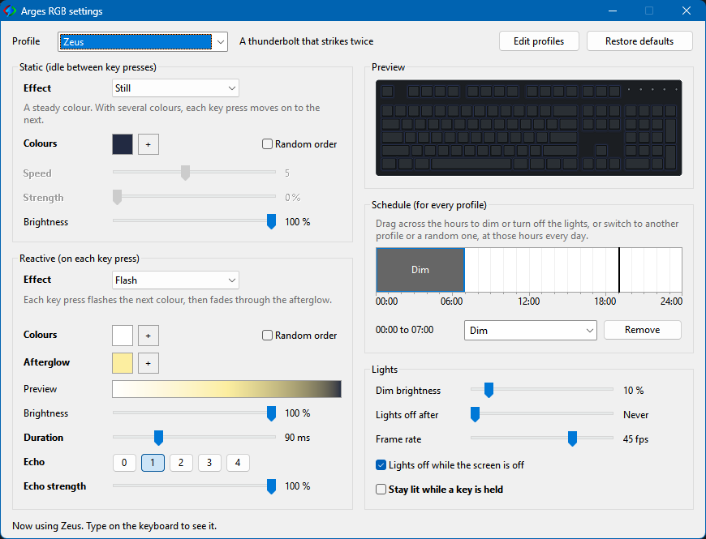

#  Arges RGB

A lightweight Windows tray app for single-zone RGB keyboards. No Razer Synapse or OpenRGB needed.

Named after Arges, the Cyclops who forged Zeus' thunderbolt. The 20 built-in profiles are inspired by Greek mythology.

## Supported keyboards

Personal project, tested only on a Razer Ornata V3 X. Contributions are welcome: add a keyboard's USB ID and packets in [`supported_keyboards.h`](src/supported_keyboards.h). The rest of the app stays untouched.

| Keyboard | USB ID | Status |
|-|-|-|
| Razer Ornata V3 X | `1532:0294` | Tested |

## Features

- **Static effects:** the keyboard's steady glow, a single colour or a gentle animation such as pulse or ember
- **Reactive effects:** a flash on each key press that fades out
- Adjustable colour, speed, brightness and duration
- 20 profiles in groups: edit them, add your own, restore defaults, or switch to a random one
- Hour schedule: dim, lights off, or switch profile
- Start with Windows, pause, dim
- Lights off when locked, screen is off, or after a set idle time
- About 2 MB of memory, no installer

## Privacy

Arges notices that a key was pressed, never which key. It records no keystrokes and makes no network connections.

## Install

1. Download `arges.exe` from [Releases](../../releases).
2. Close Razer Synapse, OpenRGB, or anything else that controls the lights.
3. Run it. Arges sits in the tray and creates `arges.ini` next to itself.

The exe isn't signed, so Windows may warn you. Click **More info**, then **Run anyway**.

## Use

Right-click the tray icon for profiles and options, or double-click it for settings. Changes save as you make them. Everything is stored in `arges.ini`, whose top lists every setting. Delete it to get the defaults back.

If you move the folder, tick **Start with Windows** again. To uninstall, untick it, quit and delete the folder.

## Build

Install [MinGW-w64](https://winlibs.com/) (`winget install BrechtSanders.WinLibs.POSIX.UCRT`), quit Arges and run `build.bat`. It runs the tests, then builds `arges.exe`.

## Licence

MIT. See [LICENSE](LICENSE).
